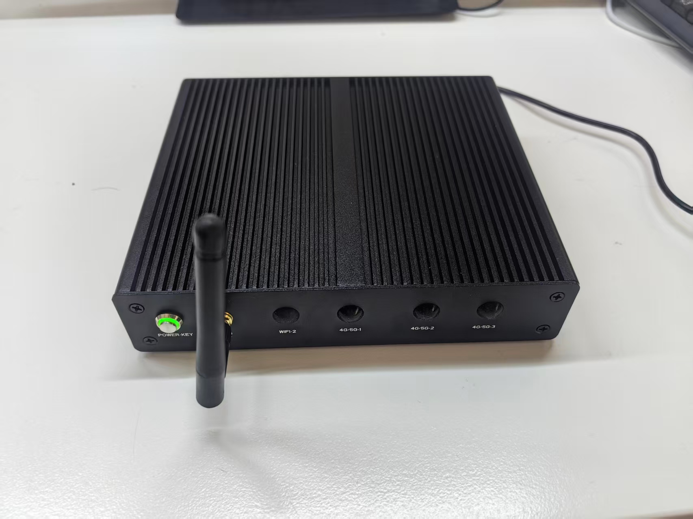
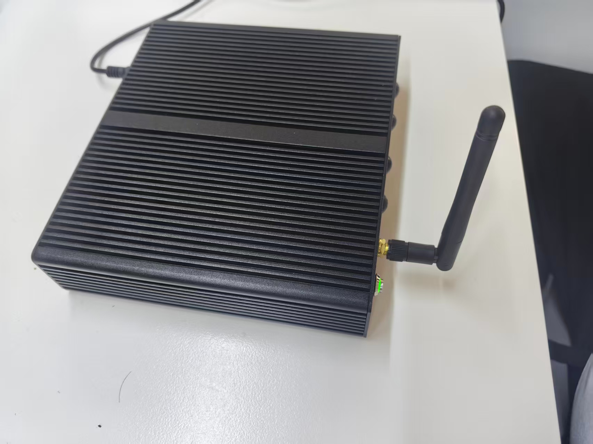
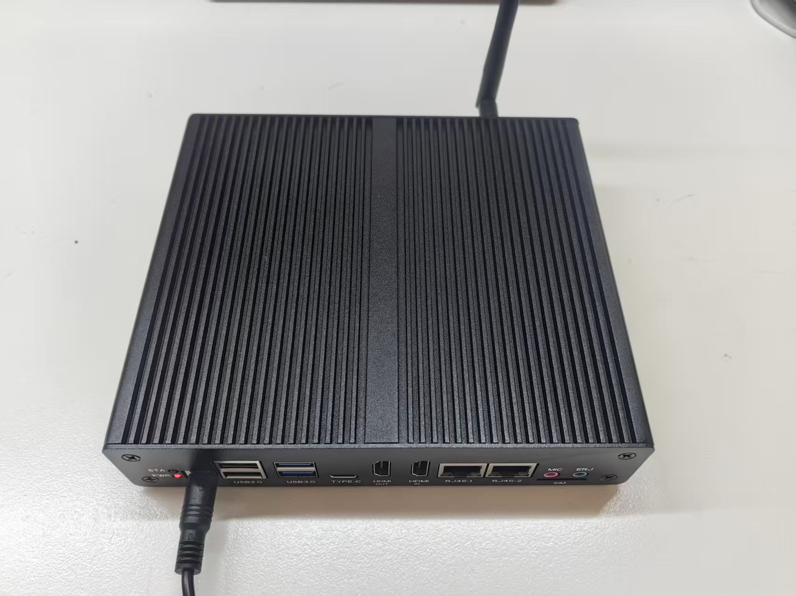

# RUNTIME-RK3588

`RUNTIME-RK3588` 是 EasyAIoT 为 **Rockchip RK3588 边缘 AI 盒子量身定制**的执行模块，不是通用 `RUNTIME` 的兼容构建。它强制使用 RK3588 的 MPP 视频引擎、RGA 图像加速器和三核 NPU；设备、驱动或 SDK 任一不满足时直接拒绝构建或启动，不会切换 ONNX Runtime、CPU 推理、软件解码或 `libx264`。

## 硬件与项目价值



前面板提供 Wi-Fi 与多路 4G/5G 天线位，适合弱网、移动点位和蜂窝备链场景。视频在盒子本地完成解码与推理，只回传检测结果、告警和按需画面，可降低上行带宽与告警时延。



大面积金属鳍片机身有利于持续视频解码和 NPU 推理时散热。运行时通过固定缓冲池、固定任务队列和三核分配控制峰值资源，避免长时间运行后队列与内存持续增长。



双 RJ45、HDMI IN/OUT、USB、Type-C 和 SIM 等接口让盒子可同时连接摄像头侧网络、平台侧网络及本地显示/存储设备，适合园区、门店、工业和交通现场的一体化部署。

RK3588 官方规格包括 4×Cortex-A76 + 4×Cortex-A55、Mali-G610、2D 图像加速器、最高 8K 编解码能力，以及支持 INT4/INT8/INT16/FP16/BF16/TF32 的 6 TOPS 三核 NPU。详见 [Rockchip RK3588 产品页](https://www.rock-chips.com/a/en/products/RK35_Series/2022/0926/1660.html)和[官方简版数据手册](https://www.rock-chips.com/uploads/pdf/2022.8.26/191/Rockchip%20RK3588%20Brief%20Datasheet%20V1.0_20250828.pdf)。

## 硬件流水线

```text
RTSP/文件
   │ FFmpeg 仅解复用压缩包
   ▼
MPP 硬解 ──► 固定数量 NV12 DMA-BUF ──────────────┐
   │                                             │
   ├──► RGA 缩放/颜色转换 ─► RKNN 预分配输入 FD ─► 三核 NPU
   │                                             │
   └──► RGA 转 BGR（画框/告警图）──► RGA NV12 ─► h264_rkmpp ─► RTMP
```

关键实现：

- MPP 通过外部缓冲组输出 NV12 DMA-BUF，缓冲数量由 `mpp_buffer_count` 限制。
- RGA 导入的 DMA-BUF 与 RKNN 输入 FD 按生命周期缓存复用，不逐帧 `import/release`。
- RKNN 输入、9 个 INT8 输出张量启动时一次分配并通过 `rknn_set_io_mem` 绑定；输入由 RGA 直接写入，YOLOv8 DFL 后处理直接读取原生 `NC1HWC2`，不逐帧转成 FP32。
- 三个工作实例固定绑定 `RKNN_NPU_CORE_0/1/2`，相同模型启用权重内存共享。
- 每个 NPU 核拥有独立任务环和完成环，调度器优先投递到最短 lane；完成结果由单独汇聚线程发布，避免三核争抢共享任务锁。
- MPP 帧环、每核任务环、每核完成环和告警结果环均为固定容量；满载时淘汰最旧帧并计数，不阻塞拉流、不无限堆积。
- 纯推理模式不创建 BGR 帧池，也不执行显示链路颜色转换；只有启用告警取证或 RTMP 输出时才分配固定 BGR 池。
- `snap` 与 `patrol` 同样使用 MPP/RGA，不调用 OpenCV `VideoCapture` 软件解码。
- RTMP 仅使用 `h264_rkmpp`；编码器缺失时失败，不回退 `libx264`。

“零内存”在这里指**零拷贝优先、零无界增长、零逐帧大块分配**，并不表示进程占用 0 字节内存。压缩包进入 MPP 时仍有一次有界拷贝，画框和告警图片也需要固定 BGR 缓冲。

实现依据：[MPP 开发指南](https://github.com/rockchip-linux/mpp/blob/develop/doc/Rockchip_Developer_Guide_MPP_EN.md)、[RKNN Runtime API](https://github.com/airockchip/rknn-toolkit2/tree/master/rknpu2/runtime/Linux/librknn_api)、[RGA 开发指南](https://github.com/airockchip/librga/blob/main/docs/Rockchip_Developer_Guide_RGA_EN.md)和[RGA FAQ](https://github.com/airockchip/librga/blob/main/docs/Rockchip_FAQ_RGA_CN.md)。

## 强制运行条件

- RK3588/RK3588S，Linux aarch64；
- 可用节点：`/dev/rknpu*`、`/dev/rga*`、MPP/VPU 节点、`/dev/dri/renderD128`；
- RKNN Runtime 2、librga、Rockchip MPP；
- FFmpeg/libavformat，以及带 `h264_rkmpp` 编码器的 Rockchip FFmpeg；
- OpenCV 只用于检测框、区域和告警图片，不承担解码、缩放预处理或推理。

```bash
./RUNTIME-RK3588/install_linux.sh preflight
./RUNTIME-RK3588/install_linux.sh build
sudo EASYAIOT_RK3588_INSTALL_DIR=/opt/easyaiot/RUNTIME-RK3588 \
  ./RUNTIME-RK3588/install_linux.sh install
```

交叉编译时必须提供 aarch64 RK3588 工具链，并通过 `ROCKCHIP_SDK_ROOT` 指向包含 RKNN/RGA/MPP 头文件和库的 SDK sysroot。CMake 在非 aarch64 或依赖缺失时会直接报错。

## RKNN 模型

运行时只接受 **Rockchip Model Zoo 优化版 YOLOv8n INT8 RKNN**。它必须是 1 输入、9 输出：三个尺度各包含 DFL 框、分类分数和分数和张量。普通 Ultralytics 单输出 ONNX/RKNN、FP 模型以及其他输出契约会在启动时被拒绝，避免“能运行但结果错”或悄悄走低性能路径。

在安装 RKNN-Toolkit2 的转换机上下载官方优化 ONNX 并转换：

```bash
./RUNTIME-RK3588/scripts/prepare_yolov8n_rk3588.sh \
  calibration.txt /opt/models/yolov8n-rk3588-int8.rknn
```

`calibration.txt` 每行一个有代表性的现场图片路径。脚本使用[官方 YOLOv8 优化模型与转换约定](https://github.com/airockchip/rknn_model_zoo/blob/main/examples/yolov8/README.md)，目标固定为 `rk3588`、INT8、优化等级 3，并在转换前验证 1 输入/9 输出契约。

## 配置

```ini
[ai]
enable=true
model_path=/opt/models/yolov8n-rk3588-int8.rknn
classes_path=/opt/models/coco.names
frame_skip=1

[rk3588]
npu_workers=3
task_queue_depth=2
frame_pool_size=6
mpp_buffer_count=8
use_sram=true
enable_perf_query=false
```

资源参数都带硬上限：NPU worker 为 1–3，`task_queue_depth` 是**每个 NPU lane** 的环深度（1–16），帧池 3–32，MPP 缓冲 4–32。实时场景建议从 `3/2/6/8` 开始；`enable_perf_query=false` 可避免逐帧性能查询影响极限吞吐，吞吐计数本身仍会持续统计。

`GET /health` 会返回 `infer_ep=rknn-rk3588-3core-ring`、`decode_ep=mpp-rk3588`、`encode_ep=h264_rkmpp`，以及 `npu_throughput_fps`、`npu_completed`、NPU 采样耗时与环队列丢帧计数。任何字段出现通用 CPU 后端都应视为部署错误；本模块本身没有这些回退代码。

## 150 FPS 真机基准

构建会同时生成 `RUNTIME-RK3588-BENCH`。它用同一套 RGA 预处理、三核线程池、原生 INT8 后处理和多环队列持续压测，默认门槛是 150 FPS：

```bash
RUNTIME-RK3588-BENCH \
  /opt/models/yolov8n-rk3588-int8.rknn test.jpg 30 150 \
  RUNTIME-RK3588/models/coco.names
```

只有输出 `BENCH_PASS` 且 `dropped=0` 才通过。这里的 150 FPS 是三核 NPU 的**聚合推理吞吐验收目标**，不是把 25 FPS 摄像头虚构成 150 FPS，也不是对任意模型、频率、温度和系统镜像的无条件承诺。真机结果低于目标时应先检查 NPU/DDR 频率策略、RKNN 驱动与 Toolkit2 版本配套、散热降频和后台负载。

## 真机验收

仓库开发机不是 RK3588 时只能做语法和逻辑检查，最终交付必须在目标盒子完成：

1. `rk3588_preflight.sh` 全部通过；
2. 连续运行至少 2 小时，进程 RSS 与 DMA 占用进入稳定区间，不随帧数线性增长；
3. `/health` 三个 EP 均为 RK3588 硬件后端；
4. 使用上述基准记录 `npu_throughput_fps`，并记录每路输入分辨率/FPS、`npu_duration_us`、端到端 P50/P95、队列丢帧和温度；
5. 同时开启目标路数、告警截图和 RTMP 后复测，确认没有热降频与驱动错误。

性能没有脱离模型、分辨率、码流和散热条件的单一“最大值”；以目标盒子的持续 P95 和稳定性为验收标准。
