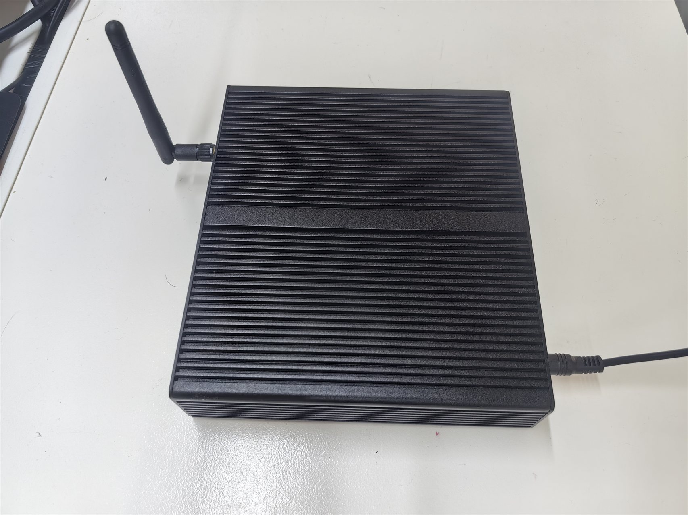

# RUNTIME-RK3588

`RUNTIME-RK3588` is an RK3588-only EasyAIoT execution runtime. It requires Rockchip MPP video decode, RGA image processing, RKNN Runtime 2 and the RK3588 three-core NPU. Missing hardware, drivers, SDK libraries, or `h264_rkmpp` is a fatal error—there is no ONNX Runtime, CPU inference, software decode, or `libx264` fallback.


Wireless and cellular expansion supports remote and weak-network sites while local inference reduces uplink bandwidth and alert latency.



The finned metal enclosure is suited to sustained video and NPU workloads. Bounded frame pools and per-model queues prevent memory growth under overload.


Dual Ethernet, HDMI, USB, Type-C and SIM connectivity support separated camera/platform networks and integrated field deployments.

## Data path

The module architecture is shown below:


The packet-level path in detail:

```text
FFmpeg demux -> MPP NV12 DMA-BUF -> RGA -> preallocated RKNN input FD -> NPU cores 0/1/2
                                  \-> RGA BGR overlay -> RGA NV12 -> h264_rkmpp -> RTMP
```

- MPP output uses a count-limited DMA buffer group.
- Imported RGA handles and RKNN input/output tensor memory are reused.
- RKNN workers are pinned to the three NPU cores and share model weights.
- Every NPU core has a dedicated bounded task ring and completion ring; a separate collector publishes results without a shared task-queue lock.
- Nine native INT8 outputs are preallocated and YOLOv8 DFL postprocessing reads `NC1HWC2` directly without per-frame FP32 conversion.
- Inference-only mode does not allocate a BGR frame pool; bounded BGR storage is enabled only for alert evidence or RTMP output.
- Snap and patrol modes use the same MPP/RGA capture path.
- Fixed-capacity queues drop the oldest stale frame instead of growing indefinitely.

“Zero memory” means zero-copy-first, no unbounded growth, and no per-frame large allocations—not literally zero bytes of process memory. The implementation follows the official Rockchip MPP, RKNN Runtime 2, and RGA interface contracts and strictly validates hardware nodes, drivers, tensor layouts, and codec capabilities.

## Standalone one-command deployment

The inference runtime itself does not require WEB, AI, VIDEO, MQTT, Docker, or any other platform module. It can stay fully offline, or optionally run one lightweight MQTT agent to join a central platform. Start from the task manifest and maintain this one file:

```bash
cp RUNTIME-RK3588/config/standalone.tasks.example.json ./rk3588.tasks.json
# Edit models and tasks, validate without changing the host, then install.
bash .scripts/docker/install_linux.sh rk3588 config-check ./rk3588.tasks.json
sudo bash .scripts/docker/install_linux.sh rk3588 install ./rk3588.tasks.json
```

The same manifest controls platform enrollment and optional remote access. With `control_plane.enabled=true`, the installer registers an MQTT agent and the box appears automatically in the standalone **Edge Computing** menu. The telemetry path is deliberately direct: `RK3588 → EMQX → iot-sink (authentication, HMAC verification, normalization, direct iot-video20 persistence) → VIDEO / WEB`; it does not pass through Kafka or NODE.

`remote_access.enabled=false` installs no frpc process and opens no public port. When enabled, service access and SSH are separate FRP tunnels. FRP is only an operator access path; heartbeat, hardware metrics, pipelines and tunnel state continue to use MQTT. Each MQTT message is protected by the node token, HMAC-SHA256, a clock window, topic/node identity checks and message-id deduplication.

The manifest deliberately matches the platform `RUNTIME` convention:

- `models` registers RKNN files, class names and optional business model IDs once; every task can reuse them;
- every `tasks` item is one RTSP stream, and its `models` array selects one or more models to run on that stream;
- every realtime stream receives its own INI, control port and supervised process, so one failed stream does not take down the others;
- all paths, references, task IDs and ports are validated before any installation starts.

The installer then performs the hardware/driver preflight, native build, shared model installation, per-stream configuration, systemd template-instance registration and startup, and checks every `/health` endpoint for the MPP/RGA/RKNN path. Without systemd, every task gets its own PID and log. The guided menu asks only for the manifest path; it no longer forces one RTSP URL and one model through environment variables.

```bash
bash .scripts/docker/install_linux.sh rk3588 list
bash .scripts/docker/install_linux.sh rk3588 status
bash .scripts/docker/install_linux.sh rk3588 logs north-gate
bash .scripts/docker/install_linux.sh rk3588 verify north-gate
bash .scripts/docker/install_linux.sh rk3588 restart north-gate
```

Without a task ID, operations cover all streams; with one, only that stream is touched. Edit `/etc/easyaiot/runtime-rk3588/tasks.json` and run `rk3588 update` to re-orchestrate an installed box. Uninstall removes the service template and binaries but preserves the manifest, per-stream configuration, models and logs. Legacy single-stream environment variables are still converted into a one-task manifest for backward compatibility. CMake only accepts an aarch64 target and requires `rknnrt`, `librga`, and Rockchip MPP; use `ROCKCHIP_SDK_ROOT` for a non-standard SDK/sysroot.

## Models

Only the Rockchip Model Zoo optimized YOLOv8n INT8 `.rknn` contract is accepted: one input and nine outputs (DFL boxes, class scores, and score sum for three scales).

```bash
./RUNTIME-RK3588/scripts/prepare_yolov8n_rk3588.sh \
  calibration.txt /opt/models/yolov8n-rk3588-int8.rknn
```

The script downloads Rockchip's optimized nine-output ONNX, validates the graph contract, and converts it for RK3588 INT8 with optimization level 3.

## Runtime configuration

```ini
[ai]
model_path=/opt/easyaiot/RUNTIME-RK3588/models/yolov8n-rk3588-int8.rknn
classes_path=/opt/easyaiot/RUNTIME-RK3588/models/coco.names
frame_skip=1

[rk3588]
npu_workers=3
task_queue_depth=2
frame_pool_size=6
mpp_buffer_count=8
use_sram=true
enable_perf_query=false
```

The build also produces `RUNTIME-RK3588-BENCH`. Run the same RGA/RKNN/ring pipeline on the target box:

```bash
/opt/easyaiot/RUNTIME-RK3588/bin/RUNTIME-RK3588-BENCH \
  /opt/easyaiot/RUNTIME-RK3588/models/yolov8n-rk3588-int8.rknn \
  test.jpg 30 150 \
  /opt/easyaiot/RUNTIME-RK3588/models/coco.names
```

`BENCH_PASS` with zero drops validates the 150 FPS aggregate three-core target. This is a hardware acceptance target, not a claim that a 25 FPS input stream becomes 150 FPS or a guarantee across arbitrary models, clocks, thermals, drivers, and system images. `/health` exposes `npu_throughput_fps`, completed tasks, sampled NPU time, and ring drops.
